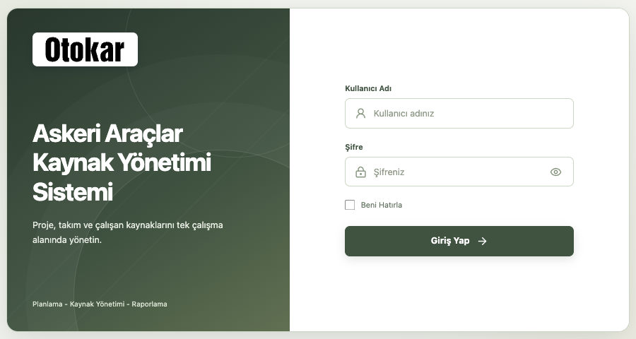
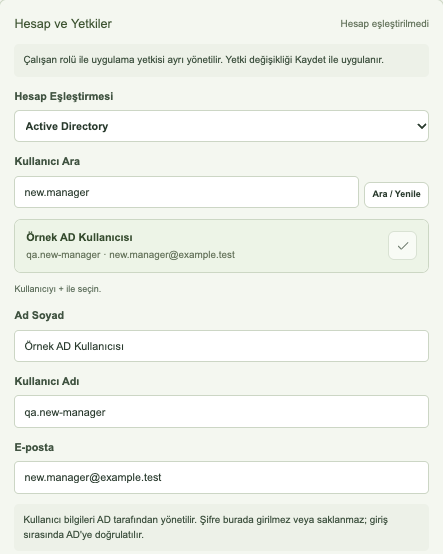
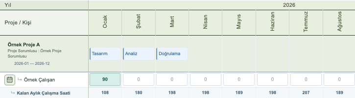
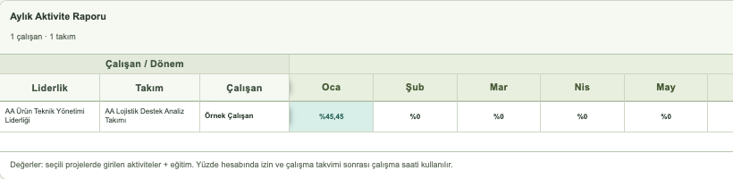
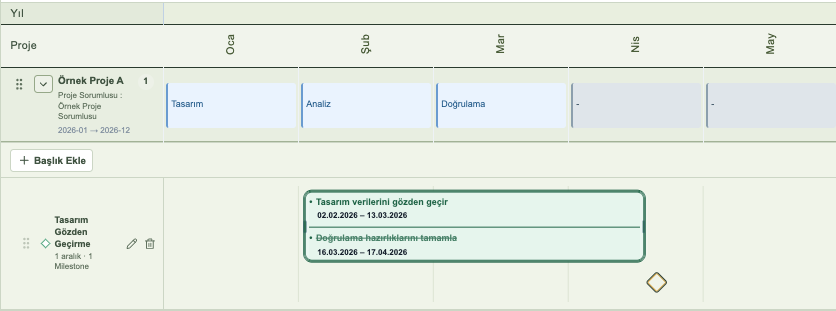
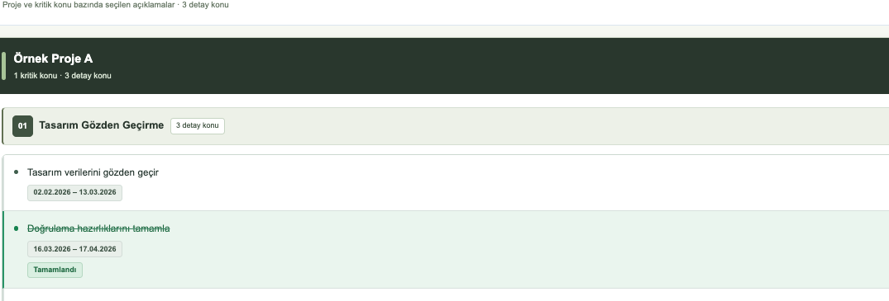

# 1. Amaç, kapsam ve okuma yolu

Bu manuel, proje ve çalışan kaynaklarının günlük kullanımını açıklar. Teknik olmayan kullanıcılar için işlem adımları; IT ekibi için kurulum, kimlik doğrulama ve işletim bilgileri ayrı bölümlerde sunulmuştur. Uygulamanın güncel ekran adı **Askeri Araçlar Kaynak Yönetimi Sistemi**; çalışma alanının proje adı **AA Kaynak Planlama Sistemi**'dir.

**Belge sürümü:** 1.0 / 13.10.2026. **Uygulama paket sürümü:** 3.0.0. İncelenen uygulama kaynakları `ed022668186fb864e44394fcafc60919133a59b4` commit'iyle kayda alınmıştır. AD Admin rolü, liderlik raporu alt kırılımları ve AD'den gelen çalışan adının korunması bu sürüme dahildir. Kurumun dağıtacağı paketin bu kaynaklarla eşleşmesi ayrıca kontrol edilmelidir.

## Kime hangi bölüm önerilir?

| Okuyucu | Başlangıç noktası |
|---|---|
| Normal kullanıcı | Oturum açma, filtreler, gerçekleşen dağılım, izin/eğitim ve aylık aktivite |
| Yönetici | Yukarıdakilere ek olarak yetki kapsamı, planlanan dağılım ve kaynak raporları |
| Admin | Çalışan/hesap, organizasyon, proje, kritik konular, içe aktarma ve yedek işlemleri |
| IT ekibi | Özellikle 22-24. bölümler; ardından belge farkları ve teyit listesi |

## Bu manuelin doğrulama sınırı

Kaynak kod ve mevcut belgeler incelenmiş; seçili akışlar geçici veritabanında, sentetik hesaplarla görüntülenmiştir. Görseller gerçek personel veya üretim verisi içermez. Gerçek kullanıcıyla oturum açılmamış; çalışan veritabanında kayıt, silme, migration veya restore yapılmamıştır.

Bu belge bir güvenlik sertifikası veya üretim kabul tutanağı değildir. Kurumun gerçek AD, MSSQL, Windows servis, TLS/proxy ve yedekleme ortamının kabulü ayrıca gerekir. Tarihsel belgelerle güncel kod arasındaki farklar 25. bölümde belirtilmiştir.

> Okuma ipucu: Kalın yazılan düğme ve alan adları arayüzdeki adları gösterir. Bir işlem sizde görünmüyorsa önce rolünüzü ve çalışan eşleştirmenizi kontrol ettirin. Başkasının hesabını kullanmayın.

---page---
# 2. Temel kavramlar ve hesaplamalar

| Kavram | Kullanıcı açısından anlamı |
|---|---|
| Kaynak / çalışan kaydı | Kişinin veya ilan ihtiyacının takım, statü, tarih ve kişi eşdeğeri bilgisi |
| Kişi eşdeğeri | Planlamadaki kapasite ölçüsü. 1 tam kaynak, 0,5 yarım kaynak anlamına gelir; saat değildir. |
| Aktif Kaynak | Planlamaya dahil kayıtların, statü ve tarihlerine göre hesaplanan kapasitesi |
| Dağıtılan Kaynak | Takım veya doğrudan liderlik biriminin projelere planladığı kaynak |
| Kalan / eksik kaynak | Aktif Kaynak - Dağıtılan Kaynak. Negatif değer eksik, pozitif değer kullanılmamış kapasitedir. |
| Gerçekleşen dağılım | Çalışanın ilgili ayda projeler için girdiği faaliyet süresi |
| Kaynak Rolü | Organizasyondaki Lider, Product Owner veya Team Member görevi |
| Uygulama rolü | Sistemde işlem yapma hakkını belirleyen Admin, Yönetici veya Normal Kullanıcı |
| Başlık / not / detay not | Proje takviminde bir başlık altındaki tarihli işler ve bunların detayları |
| Milestone | Tek bir tarihte gösterilen kilometre taşı; takvimde baklava simgesi |

## Sayılar neden farklı olabilir?

Planlama kapasitesi, çalışmanın ay içindeki takvim günü payı ve **Kişi Eşdeğeri** ile hesaplanır. Gerçekleşen dağılımda ise hafta sonu, çalışma dışı gün ve izinler saat hesabını etkiler. Bu iki hesap aynı ölçüm değildir.

Gerçekleşen verinin kişi eşdeğerine dönüşümünde **180 saat/ay** sabiti kullanılır. Otomatik aylık çalışma saati ise o ayın çalışma günlerinden türetilir; her ay 180 saat olmak zorunda değildir. Günlük çalışma hesabının kodda tanımlı temeli **9 saat**tir. Kurumun çalışma düzeni farklıysa IT/ürün sahibiyle teyit edilmelidir.

Takım yanındaki yeşil kişi sayısı, ilgili ayda planlamaya dahil çalışan statülerindeki kayıtları gösterir; ilanlar ve işten ayrılanlar bu sayıya dahil değildir. Bu sayı, kişi eşdeğeri veya geçmiş ay kapasitesi ile birebir aynı olmak zorunda değildir.

> Örnek: Aktif Kaynak 10, Dağıtılan Kaynak 12 ise kalan -2'dir. Başka bir takımda +1 varsa net toplam -1 olur. Alt liderlik satırları üst liderliğin içinde olduğundan üst ve alt satırlar ayrıca toplanmaz.

---page---
# 3. Sisteme erişim ve oturum açma

1. IT ekibinin bildirdiği uygulama adresini tarayıcınızda açın. Kurumsal kullanımda yerel bilgisayar adresini değil size verilen adresi kullanın.
2. **Kullanıcı Adı** ve **Şifre** alanlarını doldurun. AD hesabınız tanımlıysa kurum hesabınızın bilgilerini kullanın.
3. Gerekirse göz simgesiyle **Şifreyi Göster / Şifreyi Gizle** seçimini kullanın. Ekran paylaşırken şifreyi görünür bırakmayın.
4. Yalnız kişisel ve güvenilir cihazda **Beni Hatırla** seçeneğini değerlendirin.
5. **Giriş Yap** düğmesine basın. Başarılı girişte üst barda hesabınız ve rolünüz, altında erişebildiğiniz sekmeler görünür.
6. İşiniz bitince sağ üstteki **Çıkış** düğmesini kullanın. Tarayıcı sekmesini kapatmak, sunucu oturumunu açıkça sonlandırmanın yerine geçmez.

## Oturum ve hesap sorunları

AD şifresi uygulamada oluşturulmaz veya değiştirilmez; kurumun kimlik hizmetinde doğrulanır. AD bağlantısı kapalıysa veya hesabınıza uygulama yetkisi verilmemişse yalnız doğru kurum şifresiyle giriş yapmak yeterli değildir. IT'ye kullanıcı adınızı ve hata zamanını iletin; şifrenizi iletmeyin.

AD oturumunun üst sınırı, **Beni Hatırla** seçilse de 12 saattir. Yerel hesaplarda normal oturum 12 saat; hatırlanan oturum 30 gündür. Yetki değişikliği, hesap pasifleştirme veya oturum değişimi yeniden giriş gerektirebilir. Bu süreler kesintisiz erişim garantisi değildir.

> Kaydedilmemiş metni koruyun. Hesap değiştirmeden veya sayfayı yenilemeden önce tamamlanmamış girişleri güvenli bir yere alın. Her ekranın taslağının tarayıcı yeniden açıldığında kalacağı garanti edilmez.

---page---
# 4. Ana ekran ve menüler

Üst barda sistem adı, hesabınız/rolünüz, **Varsayılan Sekme** ve **Çıkış** bulunur. Varsayılan sekme seçimi ilgili kullanıcı ve tarayıcıda tutulur. Admin ayrıca **Veri Yedeği İndir** ve **Yedek Yükle** işlemlerini görür.

| Sekme | Ne için kullanılır? |
|---|---|
| AA Gerçekleşen Kaynak Dağılımı | Aylık proje faaliyet süresi girişi; çalışma saati ve kişisel takvim |
| AA Aylık Aktivite Raporu | Yetkili olunan çalışanların aylık faaliyet toplamlarının okunması |
| AA Planlanan Kaynak Dağılımı | Takım veya liderlik kaynaklarının projelere planlanması |
| AA Mühendislik Liderliği Projeler | Aşamalar, proje takvimi, başlıklar, tarihli notlar ve milestone'lar |
| AA Kritik Proje Konuları | Rapora seçilen proje notlarının takibi |
| AA Kaynak Planlama Raporları | Kapasite, eksik kaynak, gerçekleşen/planlanan ve öngörü raporları |
| Organizasyon & Çalışan & Yetki | Çalışan/hesap yönetimi ve organizasyon tanımları |

Son sekmede **Çalışan & Yetki Tanımlama** ile **Organizasyon Yapısı** adlı iki iç görünüm vardır. Sekmelerin tamamı her rolde görünmez; 5. bölümdeki matrisi kullanın.

## Ekranda gezinme

1. İlgili ana sekmeyi seçin.
2. Varsa **Görünüm** alanından Ayrıntılı, Kompakt veya 5 Yıllık Genel Bakış seçin. Genel bakış ayrıntı yerine uzun dönemi görmeye yöneliktir.
3. Filtreleri ayarlayın ve yeşil özet satırından kontrol edin.
4. Tabloda yatay/dikey kaydırma kullanın. Sabit başlıklar ve sol sütunlar, konumunuzu izlemeyi kolaylaştırır.
5. İşlemin sonucu görünmüyorsa hata/başarı mesajını ve dönemi kontrol edin; aynı kaydı tekrar tekrar göndermeyin.

**AA Risk Yönetimi** kodda korunmaktadır ancak incelenen varsayılan derlemede gizlidir. Bu manuel, risk ekranını kullanıma açılmış bir özellik olarak tarif etmez.

[Ekran görüntüsü eklenecek: rol bazında ana sekmeler ve Varsayılan Sekme alanı. Aynı kişiye ait gerçek hesap bilgileri yerine sentetik hesap kullanılmalıdır.]

---page---
# 5. Kullanıcı rolleri ve yetki matrisi

Aşağıdaki matris güncel arayüz ve sunucu kontrollerini özetler. **Görme yetkisi düzenleme yetkisi değildir.** Uygulama rolü ile Kaynak Rolü birbirinden bağımsızdır.

| İşlem | Normal Kullanıcı | Yönetici | Admin |
|---|---|---|---|
| Gerçekleşen dağılım görüntüleme | Kendi kaydı ve organizasyon kapsamındaki çalışanlar | Atanan kapsam ve kendi organizasyon kapsamı | Tümü |
| Gerçekleşen dağılım değiştirme | Yalnız kendi eşleşen kaydı | Kendi kaydı ve yetkili liderliklerin alt birimleri | Tümü |
| Kişisel izin/eğitim | Yalnız kendi kaydı | Yalnız kendi kaydı | Tüm çalışanlar |
| Ortak Çalışma Takvimi | Yok | Yok | Yönetebilir |
| Aylık Aktivite Raporu | Kendi takımının toplamları | Eşleşen çalışanın liderliğine bağlı takım toplamları | Tümü |
| Planlanan dağılım | Sekme yok | Tüm takımları görür; verilen kapsamda değiştirir | Tümü |
| Proje takvimi | Okur | Okur | Ekler/düzenler/siler |
| Kritik Proje Konuları | Sekme yok | Okur | Düzenler/tamamlar/rapordan çıkarır |
| Kaynak Planlama Raporları | Sekme yok | Görüntüler ve rapor indirir | Görüntüler ve rapor indirir |
| Organizasyon, çalışan ve hesap | Yok | Yok | Yönetir |
| Excel kaynak içe aktarma, JSON yedek/geri yükleme | Yok | Yok | Kullanabilir |

## Planlanan Kaynak Dağılımı Yetkisi

Yönetici rolünde bu alan, yazma yetkisi olan liderlikleri belirler. Bir üst liderlik seçildiğinde bağlı alt liderlikler ve takımlar da kapsanır. Tüm takımların tabloda görünmesi, hepsine veri girilebileceği anlamına gelmez.

**Önemli adlandırma ayrımı:** Alanın adı planlanan dağılımı belirtse de güncel sunucu kodu, yöneticinin başkalarının gerçekleşen dağılımlarına müdahalesini de aynı liderlik kapsamıyla sınırlar. Bu kapsam kişisel izin/eğitim kayıtlarını başkası adına düzenleme hakkı vermez.

AD kullanıcılarına **Admin** rolü atanabilir. Bu işlem yalnız mevcut Admin tarafından yapılır. Korunan ilk sistem yöneticisi kaydı, standart çalışan ekranından düzenlenemez veya yetkisizleştirilemez.

---page---
# 6. Çalışan görünürlüğü ve statüler

## Hangi çalışan hangi ekranda görünür?

Gerçekleşen dağılımda mevcut ay statüsü **Aktif Çalışan**, **SAAT Ücretli Ofis Ç.** veya **Gear Up** olan çalışanlar gösterilir. Normal Team Member ve Product Owner aynı takımdaki çalışanları okuyabilir. Kaynak Rolü Lider olan ve güncel çalışma koşullarını sağlayan kişi, bağlı liderlik/takım kapsamını okuyabilir. Başkalarının satırlarını görmek, bu satırlara giriş hakkı vermez.

Aylık Aktivite Raporu bu üç statüye ek olarak **İşten Ayrıldı** kayıtlarını da gösterir. Normal kullanıcıda kapsam eşleşen çalışanın mevcut takımıdır. Yönetici için eşleşen çalışanın liderliğinin alt birimleri kullanılır; manuel liderlik yetkisi listesi bu raporun görünürlüğünü belirlemez. Çalışan eşleşmesi yoksa veya uygun organizasyon bağı yoksa rapor boş olabilir.

| Statü | İşbaşı alanı / başlangıç davranışı | Planlama davranışı |
|---|---|---|
| Aktif Çalışan | İşbaşı Tarihi zorunlu; yeni seçimde yılın ilk günü | Dahil açıksa tarihlere göre kapasite |
| SAAT Ücretli Ofis Ç. | İşbaşı Tarihi zorunlu; yılın ilk günü | Dahil açıksa tarihlere göre kapasite |
| Gear Up | İşbaşı Tarihi zorunlu; yılın ilk günü | Dahil açıksa tarihlere göre kapasite |
| Aktif İlan | Tahmini İşbaşı Tarihi; başlangıçta boş, Dahil kapalı | Dahil açılır ve tarih girilirse kapasite |
| Pasif İlan | Tahmini İşbaşı Tarihi; başlangıçta boş, Dahil kapalı | Aktif kapasiteye eklenmez |
| İşten Ayrıldı | İşbaşı ve İşten Ayrılış Tarihi zorunlu | Dahil açıksa çalışma tarihleri içindeki kapasite korunur |

Statü değişikliği geçmiş gerçekleşen dağılımı silmez. Bir kaydın ekrandan gizlenmesi, eski faaliyetlerinin yok olduğu anlamına gelmez. **Sil** işlemi ise farklıdır: çalışanın gerçekleşen kayıtlarını kalıcı olarak kaldırabilir.

**Öngörü istisnası:** Tarihli Aktif İlan, Kaynak Planlamasına Dahil kapalı olsa bile geleceğe ilişkin çalışan öngörüsüne katılır. Pasif İlan katılmaz. Bu, planlama tablosundaki kapasiteye dahil edildiği anlamına gelmez.

---page---
# 7. Filtreleri doğru kullanma

Filtreler ekrana göre değişir. Kaynak ekranlarında **Liderlik**, **Takım**, **Proje**, **Başlangıç Ayı** ve **Görünür Dönem** bulunur; gerçekleşen dağılımda **Kişi** de vardır. Proje ekranında organizasyon filtreleri yerine proje ve dönem filtreleri kullanılır.

1. Örneğin **Liderlik** seçim kutusunu açın. Arama alanıyla listeyi daraltın; birden fazla seçim gerekiyorsa onay kutularını kullanın.
2. Liderlik altında girintili gösterilen alt liderlikleri inceleyin. Seçilen üst liderliğin bağlı takımları da kapsanır.
3. Gerekirse **Takım** ve **Proje** seçimlerini daraltın. Seçim yanında küçük yazıyla lider veya Product Owner bilgisi bulunabilir.
4. **Başlangıç Ayı** ve **Görünür Dönem** seçin. Başlangıç varsayılanı içinde bulunulan yılın Ocak ayı; dönem varsayılanı 12 aydır.
5. Özet satırında seçilen alanları doğrulayın. Planlamada **Filtrelenen Takımlar Özet Kaynak Raporu**, projelerde **Filtrelenen Projeler**, rapor/aktivite ekranlarında **Uygulanan Filtreler** görünür.
6. Tüm seçimleri başlangıç durumuna almak için **Filtreleri Sıfırla** kullanın; dönem ve görünüm de başlangıç değerlerine döner.

## Dikkat edilmesi gerekenler

- Liderlik filtresinde alt liderlikler üstlerinin altında gösterilir. Liderlik atanmamış takım, belirli bir liderlik filtresine kendiliğinden dahil edilmez.
- Ekran filtresi güvenlik yetkisi vermez; yalnız mevcut erişim içindeki görünümü daraltır.
- Proje filtresiyle bir projeyi gizlemek, çalışanın o projeye daha önce dağıttığı saati serbest bırakmaz. Kalan çalışma saati tüm proje girişleri üzerinden kontrol edilir.
- Takım → Projeler özetindeki toplamlar tüm projelere yapılan tahsisleri kapsayabilir. Yalnız görünen proje satırlarını toplayarak bu üst toplamın aynı olmasını beklemeyin.
- Çalışan kaydı düzenlerken seçili **Başlangıç Ayı**, sürümün uygulanacağı dönemi etkiler. Yanlış geçmiş/gelecek ayda düzenleme yapmayın.

[Ekran görüntüsü eklenecek: liderlikte üst/alt birim seçimi, Takım/Proje alanları ve Uygulanan Filtreler satırı. Filtre seçimleri ile sonuç tablosunun birlikte görünmesi gerekir.]

---page---
# 8. Çalışan kaydı ekleme ve düzenleme

Bu bölüm **Admin** içindir. Menü yolu: **Organizasyon & Çalışan & Yetki → Çalışan & Yetki Tanımlama**.

1. Yeni kayıt için **Kaynak Ekle / Yetki Tanımla**, mevcut kayıt için satırdaki **Düzenle** düğmesini seçin.
2. Hesabı AD ile eşleştirecekseniz 9. bölümdeki seçimi yapın. AD seçildiğinde **Ad Soyad** dizinden gelir ve elle değiştirilemez. Hesapsız kaynakta ad manuel girilebilir.
3. **Kaynak Rolü** seçin. **Lider** için liderlik zorunlu, takım gerekli değildir. **Product Owner** veya **Team Member** için takım zorunlu, liderlik isteğe bağlıdır; takımın bağlantısı kullanılır.
4. **Statü**, **Kişi Eşdeğeri**, işbaşı/ayrılış tarihleri ve **Kaynak Planlamasına Dahil** seçimini kontrol edin. İK Notu gerekiyorsa yalnız amaca uygun bilgi yazın.
5. **Kaydet** düğmesine basın. Hata yoksa pencere kapanır; kaydı tabloda adı, statüsü, tarihleri ve hesabıyla kontrol edin.
6. İlgili ayın planlama ve rapor toplamlarını da kontrol edin. Çalışan sürümleri aylık etkili olduğundan yalnız mevcut ayı incelemek yeterli olmayabilir.

## Zorunlu bilgiler ve kontroller

- Ad, geçerli organizasyon ataması ve statünün gerektirdiği tarihler tamamlanmalıdır.
- Kişi eşdeğeri 0-100 aralığındadır; giriş alanı 0,05 adımına göre düzenlenmiştir.
- İşten ayrılış tarihi işbaşı tarihinden önce olamaz. Ayrılış alanı yalnız İşten Ayrıldı statüsünde görünür.
- Aynı birimde çakışan dönemlerde ikinci **Lider** veya ikinci **Product Owner** atanamaz. Uyarıda mevcut kişinin adı gösterilir. Mevcut atamayı ve dönemlerini düzeltmeden yeni atamayı tekrar zorlamayın.

## Toplu işlem, silme ve işlem geçmişi

Satır kutularını işaretleyip **Seçilenleri Toplu Düzenle** ile takım, statü ve dahil durumunu güncelleyebilirsiniz. Toplu form hesap/AD yetkilerini topluca değiştirmez. **Seçimi Temizle** seçimi kaldırır.

**Sil / Seçilenleri Sil**, çalışan kayıtlarıyla bu kişilerin gerçekleşen dağılımlarını kaldırır; takımın planlanan proje tahsisleri korunur. Hesap yetkisini kaldırmak ile çalışanı silmek aynı işlem değildir. Ayrılan kişinin tarihsel faaliyetlerini tutmak için Sil yerine uygun statü ve ayrılış tarihi kullanılmalıdır.

Admin, **Değişiklik Geçmişi** düğmesiyle işlem yapan kişi, zaman ve değişen alanları inceleyebilir. Kaydı açınca önceki/yeni değerler görünür; **Önceki / Sonraki** ile sayfalar arasında geçilir. Geçmiş, özelliğin devreye alınmasından sonraki kayıtlarla sınırlıdır ve JSON yedeğine dahil değildir.

---page---
# 9. Active Directory hesabı ve uygulama yetkisi

AD, kurumun kullanıcı dizinidir. Çalışan kaydı ile uygulama hesabını eşleştirmek yalnız **Admin** işlemidir. Kurumsal şifre bu formda girilmez.

1. Kaynak ekleme/düzenleme penceresinde **Hesap ve Yetkiler** bölümünü bulun.
2. **Hesap Eşleştirmesi** alanından **Active Directory** seçin.
3. **Kullanıcı Ara** alanına kullanıcı adı, ad veya e-posta bilgisi yazıp **Ara / Yenile** düğmesine basın.
4. Doğru kişinin yanındaki **+** ile kullanıcıyı seçin. Sonuç çoksa aramayı daraltın; ilk 50 sonuç gösterilir.
5. Seçilen **Ad Soyad**, **Kullanıcı Adı** ve **E-posta** bilgilerini doğrulayın. AD kimlik alanları salt okunurdur. Çalışan Ad Soyad alanı da seçilen dizin adına eşitlenir.
6. **Rol** seçin: Normal Kullanıcı, Yönetici veya Admin. Yönetici için **Planlanan Kaynak Dağılımı Yetkisi** listesini düzenleyin.
7. Gerekirse **Tüm Liderlikleri Seç** veya **Seçimi Temizle** kullanın. Üst/alt liderlik ilişkilerini kontrol edin.
8. **Kaydet** sonrası tabloda E-posta Adresi, Rol/Yetki ve Yetki Kapsamı alanlarını inceleyin. Yetki değişikliği önceki oturumları kapatabilir.

## Yetkiyi kaldırma

Mevcut eşleşmede **Uygulama Yetkisini Kaldır** seçimini onaylayıp kaydedin. Çalışan kaydı korunur; hesap pasifleşir, çalışan-hesap bağlantısı ve kapsam kaldırılır, mevcut oturumlar kapatılır. Bu işlem AD hesabını kurum dizininden silmez. Tekrar yetkilendirme mevcut kimliğin eşleştirilmesiyle yapılmalıdır; ikinci bir hesap oluşturmayın.

---page---
# 10. Organizasyon yapısını yönetme

**Admin:** **Organizasyon & Çalışan & Yetki → Organizasyon Yapısı**. Bu görünüm liderlikleri, alt liderlikleri ve takımları birlikte gösterir.

## Yeni liderlik veya takım

1. **Liderlikleri Yönet** ya da **Takımları Yönet** düğmesini açın.
2. Soldaki listeden düzenlenecek kaydı seçin veya **Yeni Liderlik Ekle / Yeni Takım Ekle** kullanın.
3. **Liderlik Adı / Takım Adı** alanını doldurun. Alt liderlik oluşturuyorsanız bağlı olduğu üst liderliği; takım oluşturuyorsanız ilgili liderliği seçin.
4. Kaydetme düğmesiyle işlemi tamamlayın. Mevcut kayıtta düğme **Değişiklikleri Kaydet** olarak görünür.
5. Pencereyi kapatıp organizasyon ağacını ve kaynak ekleme seçim listesini kontrol edin.

Bir liderlik başka liderliğe bağlanabilir; kendisine veya altındaki birime bağlanarak döngü oluşturamaz. Alt liderliğin takımları kendi liderliği altında gösterilir. Planlamada doğrudan liderliğe bağlı çalışanlar da ayrı kaynak satırı olarak yer alır.

## Yönetici bilgisi nereden gelir?

Liderlik yöneticisi, çalışan kaydında **Lider** seçilen kişiden; takım yöneticisi ilgili **Product Owner** atamasından türetilir. Yönetim penceresindeki yönetici alanı manuel girişe kapalıdır. Düzeltme için ilgili çalışanın Kaynak Rolü ve birim atamasını düzenleyin.

Seçili liderlikte **Bağlı Takımlar ve Liderlikler** alanı, doğrudan ve alt liderlikler üzerinden bağlı birimleri gösterir. Çalışan listesi, güncel organizasyon/çalışan durumuna göre hazırlanır; tüm tarihsel çalışanların arşiv listesi değildir.

## Silme

**Liderliği Sil / Takımı Sil** işleminden önce bağlı kayıtları kontrol edin. Alt liderlik, çalışan veya dağılım bağlantıları silmeyi engelleyebilir; ekrandaki gerekçeyi izleyin. Bu kontrolü aşmak için veritabanından elle silmeyin. Önce uygun taşıma/atama işlemini yapın; geçmiş kayıtların nasıl korunacağını IT ile planlayın.

[Ekran görüntüsü eklenecek: Liderlik Yönetimi penceresinde seçili liderlik, salt okunur yönetici, bağlı takımlar/alt liderlikler ve çalışan listesi.]

---page---
# 11. Planlanan kaynak dağılımı

**Admin ve Yönetici:** **AA Planlanan Kaynak Dağılımı**. Planlama, çalışan bazında değil takım veya doğrudan liderlik birimi bazında kişi eşdeğeri girilerek yapılır.

1. Liderlik, takım, proje ve dönemi filtreleyin. Özet satırındaki seçimleri kontrol edin.
2. **Takım → Projeler** veya **Proje → Takımlar** görünümünü seçin.
3. Yetkili olduğunuz satırda ilgili ay hücresine tıklayın. Örneğin `0,5` girin; bu yarım kişi eşdeğeridir.
4. Enter ile girişi tamamlayın. Kaydetme sonucunu, hücre değerini ve toplamları kontrol edin. Hata halinde düzenleme tamamlanmış kabul edilmez.
5. Gerekirse **Gerçekleşen Dağılım Göster** ile karşılaştırmayı açın. Bu satırlar plan değerini değiştirmez.

Takım → Projeler başlığındaki **A / D / K**, Aktif / Dağıtılan / Kalan kaynak özetidir. Üzerine gelerek açıklamasını görebilirsiniz. Doğrudan liderlik satırında yalnız liderliğe doğrudan bağlı çalışanlar bulunur; alt takımlar ikinci kez sayılmaz.

## Hızlı ve çoklu giriş

| İşlem | Kullanım |
|---|---|
| Bir alanı seçme | Fareyi basılı tutup hücreler üzerinde sürükleyin. |
| Ayrı alanları ekleme | Ctrl tuşuyla başka hücre/alanları seçin; Mac'te ilgili kısayollarda Cmd kullanılabilir. |
| Aynı değeri dağıtma | Seçili alanın sol üst hücresine değeri girip Ctrl+Enter kullanın. |
| Kopyala/yapıştır | Seçili alanda Ctrl+C / Ctrl+V veya sağ tık menüsünü kullanın. Hedef alanı doğru seçin. |
| Seçimi kaldırma | Esc veya tablonun dışındaki boş alan; tamamlanan Enter girişi de seçimi temizler. |

Kopyalama tablo içi hücre akışıdır; başka uygulamalarla pano davranışının her tarayıcıda aynı olacağı garanti edilmez. Hücre içinde metin düzenlerken kısayol metne uygulanabilir. Beklenmeyen sonuçta Esc ile seçimden çıkıp sağ tık menüsünü kullanın. Proje dönemi dışındaki veya yetkisiz hücreler yazılamaz.

> Kapasiteyi aşan planlama uyarı rengi üretir; gerçekleşen dağılımdaki %100 sınırıyla aynı kural değildir. Admin'in **Tüm Dağılımları Sıfırla** işlemi filtrelerden bağımsız tüm liderlik, proje ve aylardaki plan tahsislerini temizler. Geri dönüş için işlem öncesi yedek gerekir.

---page---
# 12. Gerçekleşen dağılıma süre girme

**AA Gerçekleşen Kaynak Dağılımı**, çalışanın projelere harcadığı aylık süreyi gösterir. Normal kullanıcı kendi kaydını; yönetici kendi kaydını ve yetkili liderlik kapsamındaki çalışanları düzenleyebilir.

1. Proje/kişi ve dönem filtrelerini seçin. Giriş yapılacak çalışanın satırını bulun.
2. **Kaynak Dağıtım Birimi** alanından **Yüzde (%)** veya **Saat** seçin. Gün seçeneği yoktur.
3. İlgili proje-ay hücresine tıklayın. Üstteki **Çalışan**, **Ay** ve **Aylık Çalışılan Saat** bilgisinin doğru olduğunu kontrol edin.
4. Değeri yazıp Enter'a basın veya hücreden çıkın. Başarılı kayıtta değer ve alt toplam güncellenir. Sıfır girilmesi ilgili dağılımı temizler.
5. Başka projelere girişten sonra aylık toplamı kontrol edin. Gelecek aylara ve projenin çalışma dönemi dışına giriş yapılamaz.

## Aylık toplamı anlama

Yüzde görünümündeki **Dağıtılan Kaynak %'si**, tüm proje süreleri ile eğitim saatlerinin net aylık saate oranıdır. Saat görünümünde **Kalan Aylık Çalışma Saati** gösterilir:

**Kalan saat = Net aylık çalışma saati - Tüm proje saatleri - Eğitim saatleri.**

Örnek: Net kapasite 180 saat, proje toplamı 156 saat ve eğitim 9 saat ise kalan 15 saattir; dağıtılan oran yaklaşık %91,67'dir. Buradaki 180 örnek değerdir, her ayın otomatik çalışma saati değildir.

Proje süreleri ve eğitim birlikte net kapasiteyi aşamaz. **Kaynak Dağılımı Sınırı** uyarısı gelirse önce takvim, aylık saat ve diğer proje girişlerini kontrol edin. Projeyi filtreyle gizlemek sınırı düşürmez.

Yetkiniz varsa aylık çalışılan saate manuel değer girebilirsiniz; manuel değeri temizlemek otomatik takvime döndürür. Bu alan net kapasiteyi etkiler; izinleri iki kez düşmeyin.

---page---
# 13. Çalışma takvimi, izin ve eğitim

Ortak çalışma dışı günler ile kişisel izin/eğitim ayrı akışlardır. Hafta sonları otomatik düşülür; resmi tatil tarihleri kendiliğinden internetten alınmaz, Admin'in tanımladığı ortak takvim uygulanır.

## Ortak Çalışma Takvimi - Admin

1. Gerçekleşen dağılımın üst kısmında **Çalışma Takvimi** düğmesini açın.
2. **Başlangıç**, **Bitiş**, **Tür**, **Süre** ve **Açıklama** alanlarını doldurun. Türler: Resmî Tatil, Bayram Tatili, Otokar Çalışma Dışı. Süre Tam gün veya Yarım gün olabilir.
3. **Ekle** ile aralığı taslağa alın; düzeltmede **Güncelle** kullanın. Ortak aralıkta iki uç tarih de dahildir; tek girişte en fazla 62 takvim günü kapsanır.
4. **Çalışma Dışı Tarihler** listesini inceleyin; aralıklar tek satır halinde düzenlenebilir/silinebilir.
5. **Takvimi Kaydet** ile ortak değişiklikleri kaydedin. Bu son adım yapılmadan ortak takvim güncellemesi tamamlanmaz.
6. **Aylık Çalışma Saatleri** ve etkilenen çalışan toplamlarını kontrol edin.

## Kişisel izin/eğitim - çalışan veya Admin

1. Çalışan adının solundaki takvim simgesini açın: **İzin ve Eğitim Takvimi**.
2. Tür seçin. İzin için **İzin Ayrılış Tarihi / İzin Dönüş Tarihi**; eğitim için **Eğitim Başlangıç Tarihi / Eğitim Dönüş Tarihi** alanlarını doldurun.
3. **Günlük Saat** ve isteğe bağlı **Açıklama** girin. Saat 0,5-9 aralığında, 0,5 adımlıdır; bir gündeki izin ve eğitim toplamı 9 saati aşamaz.
4. **Kaydet** ile tamamlayın. Kişisel giriş doğrudan kaydedilir; ortak takvimdeki ayrı Takvimi Kaydet adımı burada aranmaz.
5. Aynı aralığı düzeltmek için **Düzenle → Güncelle**, tümünü kaldırmak için **Sil** kullanın. Liste günlük ayrı satırlar yerine girilen aralığı gösterir.

**Dönüş günü hesaba katılmaz.** 12.10.2026 ayrılış, 15.10.2026 dönüş ise 12, 13 ve 14 Ekim değerlendirilir. Tatil yoksa üç gün × 9 saat = 27 saat izin olur. Eğitimde de dönüş tarihi dışarıda kalır; tek gün için ertesi günü dönüş seçin. Aralık en fazla 366 gündür; hafta sonu ve tam tatil günlerine çalışma saati yazılmaz, yarım gün kapasitesi dikkate alınır.

İzin net aylık çalışma saatini azaltır. Eğitim çalışma süresinin içindedir, dağıtılan oran/toplama eklenir. Yönetici başkalarının gerçekleşen satırlarını düzenleyebilse bile onların kişisel takvim simgesini görmez. Admin tüm çalışanları yönetebilir. Kayıtlar ayrıca çalışan ekranının altındaki **Çalışan İzin ve Eğitim Kayıtları** raporunda gösterilir.

---page---
# 14. Aylık Aktivite Raporu

**AA Aylık Aktivite Raporu** veri giriş ekranı değildir. Gerçekleşen dağılım ve eğitim toplamlarını çalışan bazında aylık olarak özetler.

1. Sekmeyi açın; Liderlik, Takım, Proje ve dönem filtrelerini ayarlayın.
2. **Uygulanan Filtreler** satırını kontrol edin.
3. **Gösterim** alanından **Yüzde (%)** veya **Saat** seçin.
4. Solda **Liderlik / Takım / Çalışan**, üstte aylar bulunur. Sıralama liderlik, ardından takım, ardından çalışan adınadır.
5. Hücrenin üzerine gelerek tarih, proje aktivitesi, eğitim ve çalışma kapasitesi açıklamalarını inceleyin. Gereken düzeltmeyi gerçekleşen dağılım veya kişisel takvim ekranında yapın.

## Özel durumların gösterimi

- **İşbaşı öncesi:** Önceki aylar farklı biçimde gösterilir; varsa tarihsel kaydı kendiliğinden silmez.
- **İşten Ayrıldı:** Ayrılış ayından itibaren küçük açıklama görünür. Ayrılış ayındaki eski değerler korunabilir; etiketi tüm ay hiç çalışılmamış gibi yorumlamayın.
- **Bu ay başka takımda:** Takım değişikliği olan ay ilgili takım satırına ait değildir.
- **Gelecek ay:** Henüz gerçekleşen değer gösterilmez.
- Kapasite sıfırken kayıtlı süre varsa anlamlı yüzde hesaplanamaz; saat görünümüyle inceleyin.

Görünür statüler Aktif Çalışan, Gear Up, SAAT Ücretli Ofis Ç. ve İşten Ayrıldı'dır. Aktif/Pasif İlanlar bu rapora çalışan aktivitesi olarak girmez. Bir çalışan takım değiştirmişse dönem içinde birden fazla takım satırında görülebilir; bunlar otomatik olarak mükerrer faaliyet değildir.

Normal kullanıcı kendi takımını, yönetici eşleşen çalışanın liderliğine bağlı takımları görür. Admin tüm kapsamı görebilir. Bu raporda ayrı Excel düğmesi güncel arayüzde bulunmamaktadır.

---page---
# 15. Proje tanımlama ve aşama takvimi

**AA Mühendislik Liderliği Projeler** tüm rollerde okunabilir; ekleme, düzenleme, sıra değiştirme ve silme **Admin** içindir.

## Proje ekleme/düzeltme

1. **Yeni Proje Ekle** düğmesini açın.
2. **Proje Adı**, **Başlangıç Ayı** ve **Bitiş Ayı** girin. Bitiş başlangıçtan önce olamaz.
3. İsteğe bağlı **Proje Kodu** ve **Proje Sorumlusu** yazın. Kod en fazla 100, sorumlu adı en fazla 200 karakterdir.
4. **Kaydet** ile tamamlayın. Proje satırını ve dönemini kontrol edin. Proje sorumlusu, ilgili tablolarda proje adının altında küçük yazıyla gösterilir.
5. Mevcut projede **Proje Bilgilerini Düzenle** ile alanları güncelleyin. Satırdaki taşıma tutamacıyla proje sırasını değiştirebilirsiniz.

## Aşama ve görünüm

Ayın aşama kutusunu düzenlemek için çift tıklayın; **Aşamayı Düzenle** penceresinde metin ve renk seçip kaydedin. Boş aşama gri **-** olarak görünür. Üzerine gelince aşama metni imlece yakın kutuda gösterilir. 5 yıllık görünümde dolu aşamanın ilk harfi büyük/kalın görünür.

Fareyle komşu ayları seçip sağ tık menüsünden **metin**, **renk** veya **metin + renk** kopyalama/yapıştırma yapabilirsiniz; tablo içi Ctrl+C/Ctrl+V kısayolları da vardır. Kopyalanacak bölüm, örneğin Mart-Mayıs hücreleridir; tüm proje satırını seçmek zorunda değilsiniz. Hedefin proje dönemi içinde olduğunu kontrol edin.

**Haftalık Görünüm**, aylık aşamayı o ayın haftalarına yansıtır. Haftada aşama düzenlemek o aya ait aşamayı değiştirir; bağımsız haftalık aşama verisi yaratmaz. Tarihli detay notlar ise kendi tarih konumlarında ayrı kutularla gösterilebilir.

**Detayları Göster** başlık/not satırlarını topluca açar veya kapatır. **Proje Kodlarını Göster**, kod sütununu açar/kapatır; açıkken proje Excel çıktısına kod da eklenir.

> **Projeyi Sil**: Projeyle bağlantılı planlanan/gerçekleşen dağılımlar, aşamalar ve kritik konular da silinir; varsa risk kayıtları da etkilenir. Statü değiştirmek gibi görünürlük işlemi değildir. İşlem öncesi yedek ve onay gerekir; uygulamada tek adımlı geri al bulunmaz.

---page---
# 16. Başlık, not ve detay not oluşturma

Proje satırındaki **Başlık Ekle** işlemi, kritik konu takibini açar. Güncel adlar eski belgelerdeki Bilgi Ekle/Kritik Konu Ekle adlarından farklıdır.

1. **Başlık Ekle** düğmesine basın, **Başlık** alanını doldurun. Başlık altında henüz not yoksa da kaydedebilirsiniz.
2. **Kritik Detay Konular** alanında **Not Ekle** ile bir not oluşturun. İlk açılışta zorunlu boş tarih aralığı oluşturulmaz.
3. Not türünü **Tarih Aralığı** veya **Milestone (Tek Tarih)** olarak belirleyin.
4. Tarih aralığında **Detay Not Ekle** ile alt açıklamaları girin. 1.1, 1.2 gibi numaralarla izlenen her detayın metni, başlangıç/bitiş tarihi ve seçimleri vardır.
5. Görünümü ve rengi seçin. Bar varsayılanı **Çerçeveli**, alternatifi **Düz**'dür. Metinler satır içinde alt satıra geçebilir.
6. Gerekli detaylarda **Rapora Ekle** ve/veya **Tamamlandı** seçin.
7. **Kaydet** ile kapatın. Takvim barını ve gerekiyorsa kritik konular raporunu kontrol edin.

## Tarihlerin ilişkisi

Tarih aralığının üst başlangıç/bitişi salt okunurdur; detay tarihlerinin en erken başlangıcı ve en geç bitişinden hesaplanır. Bu üst tarihleri formdan elle değiştirmeyin; detay not tarihlerini değiştirin. Detay metni boş olsa da girilen tarihler üst aralığı etkiler.

Başlangıç ileri alındığında mevcut bitiş daha ilerideyse korunur; geride kalırsa başlangıca eşitlenir. Detayın başlangıcını daha erkene veya bitişini daha ileriye almak üst aralığı da genişletir.

## Milestone

Tek tarih seçeneğinde **Milestone Tarihi** ve **Milestone Adı** girin. **Milestone Görünümü** altında **Dolu / İçi Boş** seçilebilir; renk değiştirilebilir. Birden fazla detay not içeren aralık doğrudan milestone'a çevrilemez; önce içeriği düzenleyin.

Milestone başka bir barın tarihleri içine gelebilir ve barın üstünde gösterilir. Tarih aralıklı ana notların çakışması ise kontrol edilir. **Güncellemek istediğiniz tarih diğer kritik tarihlerin içerisindeki bir tarihtir. Tekrar kontrol ediniz.** uyarısında ilgili aralıkları inceleyin.

Notu silmek içeriği kaldırır; **Rapora Ekle** seçimini kapatmak yalnız rapordan çıkarır. Başlık içindeki tüm notlar silinse de başlığı boş içerikle kaydedebilirsiniz. Tamamlandı metni yeşil ve üstü çizili görünür.

---page---
# 17. Takvimde bar ve milestone kullanımı

## Taşıma ve süre değiştirme - Admin

1. **Detayları Göster** seçimini açın. İlgili başlığın barını veya milestone baklavasını bulun.
2. Barın gövdesini sol tuşla basılı tutup sağa/sola sürükleyin. Milestone'da baklavayı tutun.
3. Hareket sırasındaki tarih göstergesinden yeni başlangıç/bitişi kontrol edin; günlük tarih değişimi mümkündür.
4. Bırakın; başarılı kayıt sonrası tarihi **Başlık Düzenle** penceresinden doğrulayın. Hata/çakışma mesajı varsa işlem kaydedilmiş sayılmaz.
5. Süreyi değiştirmek için barın sol veya sağ kenarını sürükleyin. Bağlı detay notların tarihleri de bu hareketten etkilenir; formdan alt tarihleri kontrol edin. Milestone tek tarihli olduğundan süre uzatılması yerine taşınır.

Haftalık görünümde detaylar kendi tarihlerindeki kutularda görünür; aylık görünüm aynı işin daha geniş zaman ölçeğidir. Görünümü değiştirmek ayrı bir iş kopyası oluşturmaz. Baklava üzerine gelince adı ve tarihi imlecin yanında gösterilir. Düz bar üzerindeki tarihler beyaz/kalın, çerçeveli görünümde koyu/kalındır.

## Hızlı rapor seçimi

Bar veya milestone'a sağ tıklayın. Menüde hangi detayın **Rapora Ekli** olduğunu görün; ekli olmayanı ekleyin veya ekliyi çıkarın. İşlem aynı proje notundaki Rapora Ekle seçimini değiştirir. Tamamlandı ve Rapora Ekle bağımsızdır: tamamlanan konu raporda kalabilir.

Başlığın satır tutamacıyla başlıkları yeniden sıralayabilirsiniz. Yeni başlıklar alta eklenir. Kaydırma sırasında soldaki proje/başlık sütunları sabit kalır; yanlış satıra taşıma yapmamak için satır adını kontrol edin.

---page---
# 18. Kritik konular ve kaynak raporları

## AA Kritik Proje Konuları

Bu sekme Admin ve Yönetici tarafından okunabilir; düzenleme Admin içindir. Proje başlığı altında yalnız rapora seçilmiş, metni olan detaylar gösterilir. Proje sorumlusu bu raporda ayrıca gösterilmez.

1. Sekmeyi açın; proje ve başlık altında listelenen detay metni/tarihlerini kontrol edin.
2. Admin, **Başlık Ekle / Başlık Düzenle** ile proje takvimindeki aynı içeriği açabilir.
3. Detayda **Düzenle → Kaydet** ile metin/tarih güncelleyin. Aynı tarih ve çakışma kontrolleri uygulanır; değişiklik proje ekranına yansır.
4. İş bittiğinde **Tamamlandı** kullanın. Metin yeşil/üstü çizili olur. **Geri Al** tamamlandı işaretini kaldırır.
5. **Rapordan Çıkar**, rapor seçimini kapatır; proje notunu silmez.
6. **Excel'e Aktar** ile çıktı alın. Aynı proje/başlıktaki detaylar gruplu, maddeler ve tarihler halinde aktarılır.

## AA Kaynak Planlama Raporları

Önce **Uygulanan Filtreler** satırını inceleyin. Liderlik, takım, proje ve dönem seçimi sonuçların anlamını değiştirir. **Liderlik Bazında Eksik Raporu** üst ve alt liderlikleri hiyerarşik gösterir. Üst satır, alt birimlerini içerir; satırları tekrar toplamayın. Liderliği olmayan takım bağımsız birim olarak yer alabilir.

**Takım Bazında Eksik Kaynak Raporu** takım/doğrudan liderlik birimi düzeyindedir. Her iki tabloda **Toplam Eksik Kaynak**, artı ve eksi değerleri birlikte hesaba katan net toplamdır. Üst-alt liderlik mükerrer sayılmaz. Tahsis mevcut kapasiteyi %10'a kadar aşıyorsa uyarı, daha fazla aşıyorsa kritik renk kullanılır. Kapasite sıfır ve tahsis pozitifse kritik durumdur.

---page---
# 19. Grafiklerin anlamı ve Excel çıktıları

## Kaynak Planlama Raporları grafikleri

| Grafik | Hesap ve yorum |
|---|---|
| Aylık Eksik Kaynak Sayısı | Seçili kapsamın aylık net açığı: en az sıfır olmak üzere Dağıtılan - Aktif. Takımların artı kapasitesi net hesaba katılır. Sağdaki ortalama, seçilen ayların tamamına bölünür. |
| Gerçekleşen Kaynak ve Dağıtılan Kaynak | Aylık gerçekleşen proje dağılımı ile plan tahsislerini karşılaştırır; aktif kapasite grafiği değildir. |
| Proje Bazlı Dağıtılan ve Gerçekleşen Kaynak | Seçili dönemin toplamlarıdır; aylık ortalama değildir. İki seri ayrı açılabilir. En çok faaliyet olan en fazla 10 proje gösterilir; tek seri seçimi sıralamayı etkiler. Birim kişi-ay olarak yorumlanır. |
| Kaynak Planlama Süreci Etkinlik Grafiği | Gerçekleşen / Planlanan × 100. Plan sıfırken oran hesaplanamaz. Dönem oranı toplamların oranıdır; aylık yüzdelerin ortalaması değildir. |
| En Fazla Kaynak İhtiyacı Olan Takımlar | Her takımın pozitif aylık açığı, seçilen tüm aylara bölünür. Sıfır açık ayları da dahildir. Bu sıralama, tüm takımların net toplamından farklıdır. |
| Aylık Ortalama Çalışan Sayısı ve Öngörü | Seçili başlangıçtan itibaren biriken aylık çalışan sayısı ortalamasıdır; tek ayın fotoğrafı değildir. Ay içi çalışma gün payı kullanılır, Kişi Eşdeğeri miktarı kullanılmaz. Gelecek öngörüsüne tarihli Aktif İlanlar dahil edilir. |

Etkinlikte %100 üzeri, otomatik olarak iyi performans anlamına gelmez; plan dışı çalışma veya plan hatası da olabilir. Öngörü işe alım taahhüdü değildir. Grafik üzerinde ay/değer açıklamasını inceleyin.

## Dışa aktarma

1. Filtre ve dönemi ayarlayın; sonuçları ekranda kontrol edin.
2. Planlanan ve gerçekleşen dağılımda **Excel'e Aktar**; projelerde **Proje Raporunu İndir**; kaynak raporlarında **Kaynak Raporu İndir** düğmesini kullanın.
3. Kritik konuların kendi **Excel'e Aktar** düğmesi vardır. Aylık Aktivite Raporu'nda ayrı çıktı düğmesi bulunmaz.
4. İndirilen `.xlsx` dosyasını açın; dönem, sayfalar, toplamlar ve görünür sütunları kontrol edin. Projelerde Proje Kodlarını Göster açık ise kod sütunu da çıkar.
5. Kaynak raporu Excel'i liderlik ve takım sayfalarını içerir; tüm grafiklerin otomatik Excel kopyası olduğu varsayılmamalıdır.

Çıktılar personel/planlama bilgisi içerebilir. Yalnız yetkili alıcılarla kurumun onaylı kanallarından paylaşın. Dosyanın indirilebilmesi, alıcının veriye erişim yetkisini genişletmez.

---page---
# 20. Excel içe aktarma ve veri yedeği

Bu işlemler **Admin** içindir. Kaynak içe aktarma ile yedek geri yükleme farklıdır.

## Excel ile kaynak ekleme

1. **Çalışan & Yetki Tanımlama** görünümünde **Excel İçe Aktar** düğmesini açın.
2. **Excel ile Toplu Kaynak Ekle** ekranında **Excel Şablonunu İndir** ile güncel şablonu alın. Başlık ve seçenekleri koruyarak doldurun.
3. **Excel Dosyası Seç** ile `.xlsx` dosyasını yükleyin. Eski `.xls` veya makrolu dosyayı destekleniyor varsaymayın.
4. Önizlemedeki hazır, mükerrer ve hatalı satır sayılarını inceleyin. Hatalı satırlar aktarımı engeller; hataları düzeltip yeniden seçin. Mükerrer kayıtlar atlanır.
5. **[Hazır kayıt sayısı] Kaydı İçe Aktar** düğmesiyle işlemi tamamlayın; kaynak tablosundaki ad, birim, tarih ve kapasiteyi kontrol edin.

Bu akış **çalışan/kaynak kaydı ekler**. AD hesabı açmaz, uygulama rolü veya erişim yetkisi oluşturmaz. Hesap eşleştirmesini ayrıca Kaynak Ekle / Yetki Tanımla ekranından yapın.

## Veri Yedeği İndir / Yedek Yükle

Üst bardaki **Veri Yedeği İndir**, planlama verilerini JSON olarak indirir. **Hesaplar, oturumlar ve işlem geçmişi bu dosyada yoktur.** Dosya tam sistem yedeği değildir ve şifreli değildir. Personel verisi içerdiğinden kurumun güvenli depolama alanında tutulmalıdır.

1. Geri yükleme gerekiyorsa önce IT ile kapsamı ve işlem öncesi tam yedeği planlayın.
2. Admin **Yedek Yükle** ile doğru dosyayı seçsin.
3. Mevcut sunucu planlama verilerinin dosyadakilerle **değiştirileceğini** belirten onayı okuyun. İşlem birleştirme değildir.
4. Başarı mesajından sonra proje, çalışan, takvim ve tahsisleri kontrol edin. Hesap/işlem geçmişi geri geldi varsaymayın.

Kaynak silme, proje silme, tüm plan tahsislerini sıfırlama ve yedek yükleme için tek adımlı geri alma yoktur. **Rapordan Çıkar** veya statü değiştirme bu işlemlerle karıştırılmamalıdır.

[Ekran görüntüsü eklenecek: Excel içe aktarma önizlemesinde sentetik hazır/mükerrer/hatalı satırlar ve yedek yükleme onayı.]

---page---
# 21. Sık karşılaşılan durumlar ve çözümleri

| Durum | Kullanıcının yapacağı kontrol |
|---|---|
| Giriş başarısız | Kullanıcı adını kontrol edin. AD hesabı için kurum şifresini ve uygulama yetkilendirmesini IT'ye doğrulatın. Şifreyi destek kaydına eklemeyin. |
| Sekme veya düğme görünmüyor | Rolünüz, çalışan eşleştirmeniz ve dağıtım sürümü kontrol edilsin. Risk sekmesi varsayılan olarak gizlidir. |
| Takım/çalışan görünmüyor | Filtreleri, dönemi, statüyü ve organizasyon bağını kontrol edin. Görünürlük ile veri silinmesi aynı değildir. |
| Hücreye giriş yapılamıyor | Rol, liderlik yazma kapsamı, çalışan-ay ataması, proje dönemi ve gelecekteki ay kısıtını kontrol edin. |
| Kayıt başka kullanıcı tarafından değiştirildi | Değişikliğinizi koruyun. Güncel kaydı yenileyip karşılaştırın; gerekiyorsa tekrar uygulayın. Başkasının değişikliğini körlemesine ezmeyin. |
| Kaynak Dağılımı Sınırı | Tüm proje saatleri + eğitim, net aylık kapasiteyi aşıyor olabilir. Gizli projeler, izin ve manuel çalışma saatini kontrol edin. |
| Tarih/çakışma hatası | Başlangıç-bitiş sırasını, proje dönemini ve diğer not aralıklarını kontrol edin. Milestone için barla örtüşme izinlidir; her aralık türü aynı kurala tabi değildir. |
| İkinci Lider/Product Owner atanamıyor | Uyarıdaki mevcut kişiyi ve atama dönemini kontrol edin. Aynı birimde çakışan görev oluşturulamaz. |
| Sunucu meşgul / 503 | Bir süre bekleyip korunan taslağı yeniden kaydedin. Çok kez arka arkaya basmayın; sürerse zaman ve ekranı IT'ye iletin. |
| Bağlantı kesildi, kayıt sonucu belirsiz | Aynı işlemi hemen tekrar göndermeyin. Sunucu durumunu kontrol ettikten sonra görünen uzlaştırma/yeniden deneme adımını izleyin. |
| Oturum değişti / yeniden giriş | Tamamlanmamış metni güvenli biçimde koruyun; tekrar giriş yapın ve doğru hesabı kontrol edin. Birden fazla sekmede farklı hesapla çalışmayın. |
| Çok fazla giriş denemesi / 429 | Denemeyi durdurup bekleyin; sürerse IT'ye başvurun. Başkasının hesabıyla aşmaya çalışmayın. |
| Excel açılmıyor veya beklenmeyen değer | Dosyanın tamamlandığını, `.xlsx` olduğunu ve filtre/dönemi kontrol edin. Excel sürümüyle birlikte sentetik örnek veya kişisel verisiz hata mesajını iletin. |

## Destek kaydında ne paylaşılmalı?

Ekran/sekme adı, yaklaşık saat, uygulanan filtreler, beklenen ve görülen sonuç, kişisel verileri kapatılmış ekran görüntüsü. Parola, oturum çerezi, token, bağlantı anahtarı, gerçek yedek veya çalışan listesini genel destek kanalına göndermeyin.

Başarı mesajı görmeden pencerenin kapanmasını kaydın kesin kanıtı kabul etmeyin. Önemli bir güncellemeden sonra ilgili hücre, tarih ve rapor toplamını tekrar kontrol edin.

---page---
# 22. IT için ortam ve kurulum

**Bu bölüm IT içindir.** Son kullanıcıların paket kurması, veritabanı geçişi veya servis yönetimi yapması gerekmez. Komutlar belge amaçlıdır; bu manuel hazırlanırken çalışan sisteme uygulanmamıştır.

| Bileşen | Kod/belgeyle doğrulanan gereksinim |
|---|---|
| Node.js | 24 veya üzeri; sunucu ortak TypeScript iş kurallarını doğrudan yükler. |
| npm bağımlılıkları | Kök ve frontend paket kilit dosyalarından kurulur. Derleme/kalite makinesinde geliştirme bağımlılıkları gerekir. |
| Arayüz / sunucu | React/TypeScript arayüz, Node.js/Express sunucu. Statik arayüz `site/` altında derlenir. |
| Veritabanı | SQL.js yerel geliştirme içindir; üretimde MSSQL gerekir. SQL.js üretim modunda reddedilir. |
| MSSQL | OPENJSON için uyumluluk seviyesi en az 130; kullanılan sürüm ve sürücü kurum ortamında kabul edilmelidir. |
| Ağ / TLS | Üretim uygulama adresi HTTPS olmalıdır. MSSQL ve AD için sertifika güveni doğrulanmalıdır. |
| Tarayıcı | Sentetik görsel kontroller Chrome ile yapılmıştır. Kurumun Edge/Chrome sürümleri ayrıca kabul edilmelidir. |

## Windows'ta ilk kurulum / yerel başlatma

1. Node.js sürümünü kontrol edin: `node --version`.
2. PowerShell'de uygulamanın `package.json` dosyasının bulunduğu klasöre geçin. İç içe klasör varsa dış paket adını değil bu kökü seçin.
3. İlk yapılandırma ve etkileşimli yerel başlatma için `./baslat-windows.cmd` çalıştırın. Başlatıcı ayarları hazırlar, bağımlılıkları kurar ve arayüzü derler. Mevcut `.env` otomatik değiştirilmez.
4. İlk yönetici bilgilerini kurulum akışında belirleyin; gerçek bilgileri bu belgeye veya Git'e yazmayın. Tarayıcıda yapılandırılmış uygulama adresini açın.

Mac için eşdeğer başlatıcı: `bash baslat-mac.sh`. Yerel adres ile üretim adresi aynı varsayılmamalıdır. Kurulumda belirlenen APP_ORIGIN ile tarayıcıdaki adres eşleşmelidir; localhost ve 127.0.0.1 birbirinin her durumda yerine kullanılamaz.

> Başlatıcı Windows servisi kurmaz. Sürekli kurumsal işletim için IT ayrıca servis yöneticisi, çalışma dizini, servis hesabı, yeniden başlatma ve log politikası belirlemelidir. Çalışan ortamda ikinci bir kopya açmak port/veritabanı kilit hatasına yol açabilir.

---page---
# 23. IT için dağıtım ve AD bağlantısı

## Derleme ve dağıtım komutlarının etkisi

| Komut | Etkisi / sınırı |
|---|---|
| `npm ci --include=dev` | Kök bağımlılıklarını kurar; node_modules değişir. |
| `npm --prefix frontend ci --include=dev` | Frontend bağımlılıklarını kurar. |
| `npm run build` | Tip kontrolü yapar; arayüz ve dağıtım manifestini üretir. Veritabanı migration'ı değildir. |
| `npm run deploy:verify` | Kaynak ve derleme dosyalarının eşleşmesini okur; veritabanına bağlanmaz. Çalışan sürecin sürümünü kanıtlamaz. |
| `npm run deploy:package -- --output "../AA-dagitim"` | Yeni/boş hedefte temiz paket üretir. Ayarlar, DB, node_modules ve Git geçmişi eklenmez. |
| `npm start` | `.env` ile sunucuyu başlatır; paket doğrulaması DB açılmadan önce yapılır. Derleme yapmaz; DB'ye bağlanır. |
| `npm run db:check` | Yapılandırılmış MSSQL'e bağlanıp temel bağlantı/uyumluluk/tablo kontrolü yapar. Tam şema veya iş kabul testi değildir. |
| `npm run db:migrate` | DB şeması ve gerekli başlangıç verilerini yazar. Yalnız bakım planıyla, yedek ve yetkili hesapla çalıştırılır. |

Üretim servis komutu `node --env-file=.env backend/server.mjs` olabilir; çalışma dizini paket kökü olmalıdır. Servis başlangıcına etkileşimli kurulum veya internetten paket indirme eklemeyin. Değişiklikte kontrollü durdurma, yedek, yeni sürüm hazırlama, gerekiyorsa migration, doğrulama, başlatma ve kabul sırası izlenmelidir.

## Windows Active Directory / LDAP

Kod **LDAPS** bağlantısını, TLS sertifika/ad doğrulamasını ve salt okunur dizin aramasını destekler. Kullanıcı şifresi AD'de doğrulanır; uygulama AD'de kullanıcı/şifre oluşturmaz. Tarayıcıdan otomatik Windows oturumu veya AD grubundan otomatik Admin rolü ataması uygulanmış kabul edilmemelidir.

IT tarafından sağlanacak ayar adları: `AD_ENABLED`, `AD_LDAP_URL`, `AD_BASE_DN`, `AD_BIND_DN`, `AD_BIND_PASSWORD`; gerekiyorsa `AD_GROUP_DN` ve `AD_CA_FILE`. Gerçek değerler, servis hesabı parolası ve sertifika/bağlantı sırları bu manuelde yer almaz. `.env` ve hizmet hesabı erişimi dosya izinleriyle korunmalıdır.

AD dizin kimliği sabittir; uygulama yetkisi ayrıca Admin tarafından atanır. Devre dışı hesabın aktiflik kontrolünde yaklaşık 60 saniyelik olumlu önbellek bulunabilir. AD bağlantısı bozulunca yerel şifreye otomatik geçiş yapılmaz. AD şifre değişikliği tek başına mevcut uygulama oturumunu anında sonlandırma garantisi vermez; AD oturum üst sınırı 12 saattir. Kurumun zorunlu oturum kapatma politikası ayrıca teyit edilmelidir.

---page---
# 24. IT için işletim, yedek ve sorun giderme

## Veritabanı ve bakım sınırları

Güncel migration kataloğunun en yüksek sürümü **35**'tir. Eski belgelerdeki daha düşük sürümler tarihsel bilgi olabilir. Migration dosyaları elle değiştirilmemeli; katalog ve geçmiş doğrulamaları korunmalıdır. Çalışan ortam migration'ı belge hazırlama veya test amacıyla çalıştırılmamalıdır.

MSSQL için ayrı uygulama veritabanı, asgari runtime yetkisi ve ayrı migration yetkisi planlayın. Şema tabloları `dbo.kp_*` yapısındadır. Kod SQL/NTLM seçenekleri içerir; parola gerektirmeyen Kerberos/gMSA/otomatik Windows SSO desteği varmış gibi devreye almayın.

## Yedekleme ve saklama

- Ekrandaki JSON yedeği tam yedek değildir. MSSQL'de DBA'nın yerel SQL Server yedek/restore süreçleri uygulanmalıdır.
- SQL.js bakım araçları tam dosya yedeği, bütünlük doğrulama ve oturumları kaldıran kurtarma kopyası hazırlama içindir; MSSQL'e SQLite dosya prosedürü uygulanmaz.
- İşlem geçmişi saklama politikası 5 takvim yılıdır. Otomatik silme zamanlayıcısı kurulmuş değildir; IT'nin arşiv/önizleme/onaylı bakım planı gerekir.
- Tam yedek hesap ve oturum bilgileri içerebilir. Şifreleme, saklama, erişim, anahtar yönetimi ve silme politikası kurum tarafından belirlenmelidir.
- Yedek alındı mesajı kurtarmanın çalıştığını kanıtlamaz. Ayrı geçici ortamda geri dönüş süresi ve veri doğruluğu kabul edilmelidir.

## Temel tanılama

1. **Paket eşleşmiyor:** Doğru sürüm klasörünü ve `deploy:verify` sonucunu kontrol edin. Aynı klasörden derleyin; çalışan süreci kontrollü yeniden başlatın. Manifest kontrolünü kapatmayın.
2. **Port kullanımda / DB kilitli:** Başka kopya/servisi belirleyin. Kilit dosyasını veya DB kaydını nedenini anlamadan silmeyin.
3. **DB bağlantısı yok:** Hedef, ağ, servis hesabı yetkisi, TLS zinciri ve uyumluluk seviyesini kontrol edin. Sertifika doğrulamasını üretimde kapatmayın.
4. **AD hatası:** LDAPS erişimi, CA güveni, dizin arama hesabı ve filtre/üyelik kapsamını kontrol edin. Sırları loga veya destek kaydına dökmeyin.
5. **Yavaşlık / meşgul:** Süre, eşzamanlı kullanıcı, satır sayısı, DB kilitleri ve proxy süre sınırlarını ölçün. Sınırları yükseltmek tek başına kapasite çözümü değildir.

Yazma kabul sınırlarının varsayılanı uygulama süreci başına 2 aktif, 8 bekleyen istek ve 5 saniye kuyruk beklemesidir. Başlamamış istek 503 ile reddedilebilir; başlamış işlem bağlantı koptuğunda yine tamamlanabilir. Kör otomatik yeniden gönderim, aynı işi iki kez üretme riski taşır. Çoklu servis ve gerçek yük kapasitesi ayrıca ölçülmelidir.

---page---
# 25. Belge farkları ve teyit listesi

## Mevcut belgelerle güncel kod arasındaki farklar

| Kaynaklardaki eski ifade | Güncel kodla esas alınan durum |
|---|---|
| README'deki AA Mühendislik Liderliği sistem adı | Giriş/üst bar: Askeri Araçlar Kaynak Yönetimi Sistemi |
| Ayrı Yetki Kontrol Ekranı, Hesaplar ve Yetkiler, AD Kullanıcısına Yetki Tanımla | Organizasyon & Çalışan & Yetki içinde birleşik Kaynak Ekle / Yetki Tanımla |
| AD rollerinin yalnız Normal/Yönetici olması | Güncel çalışma ağacında AD hesabına Admin seçeneği de var |
| Team Member/Product Owner için liderlik zorunluluğu | Takım zorunlu, liderlik isteğe bağlı; Lider için liderlik zorunlu |
| Lider yönetici adının serbestçe girilmesi / birden fazla atama yaklaşımı | Çalışanın Kaynak Rolü'nden türetilir; çakışan ikinci Lider/PO engellenir |
| Kalan kaynak adı veya yalnız en üst liderlik raporu | Eksik raporu adı ve alt liderlik kırılımları; genel toplam mükerrer sayılmaz |
| Eski şema sürümleri ve CI sonuçları | Katalog 35; tarihsel CI kanıtı güncel çalışma ağacının tamamını doğrulamaz |

Bu farklar özellikle README, ACTIVE-DIRECTORY-LDAP ve tarihsel iyileştirme notlarında görülür. Manuelde güncel kodun davranışı esas alınmıştır; eski belgeler tamamen güncel kabul edilmemelidir.

## Doğrulanması gereken konu

| Konu | Teyit sahibi / neden |
|---|---|
| Yayın adresi, destek kanalı, hizmet saatleri | IT; çalışma alanında kurumsal nihai değerler doğrulanmadı |
| Gerçek AD arama, giriş, pasifleştirme ve grup kapsamı | IT; yalnız sentetik dizin kullanıldı, kurum bağlantısı denenmedi |
| Admin atama onayı ve en az yetki politikası | IT / ürün sahibi; teknik seçenek kurumsal onay süreci değildir |
| Planlanan yetki alanının gerçekleşen yazma kapsamını da etkilemesi | Ürün sahibi; kod doğrulandı, alan adı kapsamı tam anlatmıyor |
| Windows servis yöneticisi, hesabı ve açılışta çalışma | IT; gerçek servis kurulmadı/denenmedi |
| MSSQL, TLS/proxy, yedek geri dönüş, çoklu sunucu ve yük | IT/DBA; gerçek kurum ortamında kabul yapılmadı |
| 9 saat/gün ve 180 saat/kişi-ay sabitlerinin uygunluğu | Ürün sahibi/İK; kod değeri doğrulandı, kurum politikası teyit edilmeli |
| Excel/tarayıcı sürümleri ve yazdırma uyumu | IT; sentetik Chrome kontrolleri tüm istemcileri kapsamaz |
| Risk ekranının devreye alma tarihi ve kabulü | Ürün sahibi; mevcut varsayılan derlemede gizli |
| Kurum içi sınıflandırma, belge onayı ve dağıtım listesi | IT/ürün sahibi; bu manuelde sınıflandırma veya resmi onay varsayılmadı |

---page---
# 26. Sözlük ve doğrulama izi

## Kısa sözlük

| Terim | Açıklama |
|---|---|
| AD / LDAP / LDAPS | Kurumsal kullanıcı dizini; dizine erişim yöntemi; şifreli bağlantı biçimi |
| Admin | Uygulamadaki en geniş yönetim rolü; AD yöneticiliği ile aynı şey değildir. |
| Product Owner | Takımın kaynak rolü; uygulamadaki Yönetici rolünü kendiliğinden vermez. |
| Revision / sürüm çakışması | Aynı kayıt başkası tarafından değiştirildiğinde eski kaydın üstüne yazmayı engelleyen kontrol |
| Migration | Yeni uygulama sürümüne uygun veritabanı yapısını hazırlayan, veri yazabilen geçiş |
| TLS / proxy | Şifreli bağlantı / uygulama önündeki ağ geçidi. Gerçek yapılandırmayı IT belirler. |
| Kişi-ay | Kişi eşdeğeri değerlerinin seçilen aylar boyunca toplamı |
| Taslak | Henüz başarılı biçimde kaydedilmemiş düzenleme |
| Salt okunur | Görüntülenebilir ama değiştirilemez |
| Sentetik veri | Gerçek çalışanı temsil etmeyen, test amacıyla üretilmiş veri |

## Kaynak kod ve dokümantasyon izleri

Bu yollar proje köküne göredir. Son kullanıcıların dosyaları açması gerekmez; IT'nin belgeyi güncel sürümle karşılaştırabilmesi için verilmiştir.

| Bölümler | Başlıca doğrulama kaynakları |
|---|---|
| 1-7: ad, menü, erişim, filtre | `frontend/src/branding.ts`, `settings.ts`, `main.tsx`; `features/WorkspaceNavigation.tsx`, `WorkspaceHeader.tsx`; `shared/access.ts`; `backend/actual-view.mjs`; `shared/employee-directory.ts` |
| 8-10: çalışan, AD, organizasyon | `features/editors/ResourceEditorFields.tsx`; `features/access/AccessPermissionFields.tsx`; `shared/resource-policy.ts`, `resource-roles.ts`; `backend/employee-account-command.mjs`, `user-commands.mjs`; `features/team-directory/DirectoryManagementDialog.tsx` |
| 11-14: plan/gerçekleşen/takvim/aktivite | `features/PlannedAllocationPanel.tsx`; `features/actual-allocation/ActualAllocationTable.tsx`; `features/work-calendar/*`; `shared/actual-units.ts`, `calendar-rules.ts`, `activity-report.ts`; `features/activity-report/MonthlyActivityReport.tsx` |
| 15-18: proje ve kritik konular | `features/editors/ProjectEditorFields.tsx`; `MilestoneDateEditor.tsx`, `MilestoneTrack.tsx`, `ProjectTimelineRows.tsx`, `ProjectInfoReport.tsx`; `features/PortalEditorDialog.tsx` |
| 18-20: rapor ve çıktı | `features/RemainingResourceTable.tsx`, `features/resource-report-groups.ts`; `shared/monthly-shortage-trend.ts`, `resource-planning-reports.ts`, `headcount-trend.ts`; `resource-report-export.ts`; `features/workspace/workspace-data-actions.ts`; `ResourceImportPanel.tsx` |
| 22-24: IT | `package.json`, `README.md`; `backend/active-directory.mjs`, `migration-catalog.mjs`; `DAGITIM-DOGRULAMA-KILAVUZU.md`, `ACTIVE-DIRECTORY-LDAP.md`, `WINDOWS-BASLATMA-VE-SERVIS-KILAVUZU.md`, `VERI-SAKLAMA-VE-YEDEKLEME.md`, `IT-MSSQL-GECIS.md` |

## Bu hazırlıkta yapılan kontroller

`node scripts/verify-deployment.mjs`: kaynak/derleme eşleşmesi başarılı; DB bağlantısı kurulmadı. Seçili dört test dosyasında **77 test başarılı**: `editor-commands`, `record-access-http`, `xlsx-workbook`, `leadership-report-hierarchy`. HTTP testleri geçici SQL.js ve sentetik hesap kullanır; sonuçlar gerçek AD/MSSQL kabulü değildir. Altı ekran görüntüsü ayrı geçici SQL.js ortamında üretildi; tarayıcı sayfa hatası gözlenmedi. Tip kontrolü, biçim kontrolü ve ortak modül bağımlılık denetimi başarılıdır. AD Admin, birleşik çalışan/hesap ve hiyerarşi için 16 hedefli sentetik tarayıcı kontrolü de geçti.

PDF ayrıca yeniden açılmış, metin ve sayfa yapısı kontrol edilmiş, sayfaları görsele dönüştürülerek okunabilirlik açısından incelenmiştir. Bu kontroller tüm uygulamaya ait güvenlik veya performans incelemesinin yerine geçmez.
